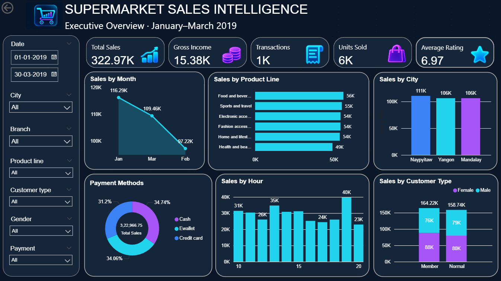

# Supermarket Sales Analysis & Intelligence Dashboard

An end-to-end supermarket sales analytics project combining **Python exploratory data analysis** with an **interactive Power BI dashboard**. The project explores sales performance across product lines, cities, branches, payment methods, customer types, and transaction hours.

## Dashboard Preview



> The dashboard screenshot is a static preview. Download the Power BI report below to interact with its slicers and visuals in Power BI Desktop.

## Power BI Dashboard

**[Open the Power BI report file](Dashboard/Supermarket%20Sales%20Intelligence.pbix)**

The report includes:

- **KPI cards:** Total Sales, Gross Income, Transactions, Units Sold, and Average Rating.
- **Sales by Month:** Monthly sales trend for January–March 2019.
- **Sales by Product Line:** Comparison of sales across six product categories.
- **Sales by City:** Sales comparison across Naypyitaw, Yangon, and Mandalay.
- **Payment Methods:** Sales distribution for Cash, Ewallet, and Credit card.
- **Sales by Hour:** Sales across transaction hours.
- **Sales by Customer Type:** Member vs. Normal customers, split by gender.
- **Interactive slicers:** Date, City, Branch, Product line, Customer type, Gender, and Payment.

### Key dashboard figures

| KPI | Value shown in dashboard |
|---|---:|
| Total Sales | 322,966.75 |
| Gross Income | 15,379.37 |
| Transactions | 1,000 |
| Units Sold | 5,510 |
| Average Rating | 6.97 |

These values reflect the all-data dashboard view shown in the screenshot. The dashboard's date slicer and other filters can change chart values.

## Python Exploratory Data Analysis

The Jupyter notebook explores transaction-level data and uses visualizations to investigate relationships among product lines, unit prices, customer ratings, payment methods, cities, and gross income.

### Objectives

- Inspect and prepare supermarket transaction data.
- Explore product-line and customer-related patterns.
- Visualize distributions and relationships in the data.
- Investigate time-based gross-income patterns by city.

### Tools and technologies

- Python
- Pandas
- Matplotlib
- Seaborn
- Plotly
- Jupyter Notebook
- Microsoft Power BI
- Power Query
- DAX

## Repository Structure

```text
supermarket-sales-analysis/
├── Dashboard/
│   ├── README.md
│   ├── Supermarket Sales Intelligence.pbix
│   └── dashboard-overview.png
├── data/
│   ├── README.md
│   └── supermarket_sales_cleaned_repaired.csv
├── dax/
│   ├── README.md
│   └── PowerBI_DAX_Measures.txt
├── power-query/
│   ├── README.md
│   └── PowerBI_PowerQuery_M.txt
├── requirements.txt
├── supermarket_sales.csv
├── supermarket_sales_cleaned.csv
├── supermarket_sales_analysis.ipynb
└── README.md
```

The structure above describes the intended organization. File names or locations may differ slightly in the repository.

## Run the Python Notebook Locally

1. Install Python 3.10+ and Jupyter.
2. Install dependencies:

   ```bash
   pip install -r requirements.txt
   ```

3. Make sure you have permission to use the dataset. Place it at the path expected by the notebook, or update the CSV path in the notebook.
4. Open `supermarket_sales_analysis.ipynb`.
5. Run the notebook cells from top to bottom.

## Open the Power BI Report

1. Download `Dashboard/Supermarket Sales Intelligence.pbix` from this repository.
2. Open it in Power BI Desktop.
3. If prompted for a data source, select the repaired CSV in `data/` and confirm the column names and data types.
4. Refresh the report and verify the totals.

The PBIX file may retain a local source path from the computer where it was created, so another computer may need the source path updated.

## DAX and Power Query

- `dax/PowerBI_DAX_Measures.txt` — reference measures for common sales KPIs.
- `power-query/PowerBI_PowerQuery_M.txt` — example Power Query M code for importing the CSV.

Review any example paths and table/column names before using the code in your own report.

## Data and Licensing

Only redistribute the dataset if its source and license permit it. Keep the dataset's attribution or license information where required. The cleaned dataset is provided as a supporting file for this analysis; check its source and licensing before public redistribution.
